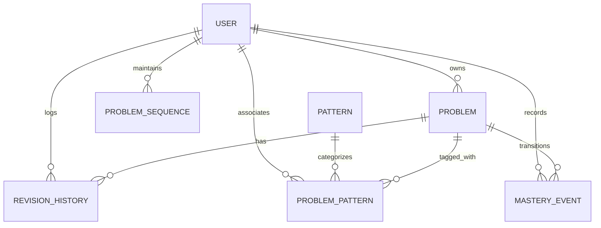

# DSA Tracker — MERN Stack Spaced Repetition Platform

> A personal DSA learning and long-term retention platform built with the MERN stack (React 18, Vite 6, Node.js, Express, MongoDB, TypeScript). Combines structured problem tracking with active recall, deterministic spaced repetition (SRS), 4-gate mastery qualification, and pattern-oriented analytics.

---

## 1. Project Overview

**DSA Tracker** is engineered for structured problem management and long-term algorithmic retention. Unlike generic note-taking tools or static spreadsheets, DSA Tracker enforces an active recall workflow coupled with a deterministic spaced repetition scheduling engine.

### Core Capabilities:
- **Two Distinct Problem Trackers**:
  - **College DSA**: Track coursework, lecture concepts, lab assignments, and semester exam problems.
  - **Personal DSA**: Manage independent problem-solving, LeetCode practice, and technical interview preparation with optional LeetCode problem numbering.
- **Zero-Gap Sequential Numbering (S.No.)**: Per-user, per-section atomic counters (`College: 1, 2, 3...` and `Personal: 1, 2, 3...`) guaranteeing gap preservation upon deletion.
- **Dual Problem Links**: Independent optional links for both academic/college portals and LeetCode problems, supporting decoupled LeetCode problem numbers.
- **Deterministic 10-Stage Spaced Repetition (SRS)**: Adaptive interval scheduling (`0d → 1d → 3d → 7d → 14d → 30d → 60d → 120d → 240d → 365d`) with an active recall UI (notes hidden during recall).
- **Proof-of-Learning Mastery System**: A strict **4-gate qualification** model ensuring problems only achieve locked mastery after meeting objective evidence of solved status, spaced repetition maturity, independent cold recall, and recent review success.
- **Pattern Library & 5-Factor Mastery Engine**: 30 foundational DSA patterns with real-time multi-factor mastery scoring calculated across coverage, cold recall, quality, consistency, and problem transfer.
- **Command Center Dashboard**: Unified derived analytics computed on-the-fly via parallel aggregations: review queues, calendar-day timing, 365-day UTC activity heatmap, streak tracking, pattern strengths, and recent activity.
- **Multi-Layered Security Architecture**: Scoped multi-tenant queries (`req.user.userId`), HTTP-only SameSite JWT cookies, dual-tier rate limiting, Helmet security headers, Zod validation, ReDoS regex escaping, and defense-in-depth URL sanitization.

---

## 2. Core Implemented Features

| Feature | Description | Implementation Status |
| :--- | :--- | :--- |
| **College DSA Tracker** | Coursework, lab, and exam problem tracking with dedicated academic source tags. | Verified Complete |
| **Personal DSA Tracker** | Independent LeetCode practice with LeetCode numbering and dedicated interview sources. | Verified Complete |
| **Atomic S.No. Sequencing** | Non-colliding, gap-preserving sequential counters per user per section via `ProblemSequence`. | Verified Complete |
| **Dual External Links** | Independent `collegeLink` and `leetcodeLink` with safe HTTP/HTTPS URL validation. | Verified Complete |
| **10-Stage SRS Engine** | Adaptive intervals up to 365 days with recovery sequences and UTC calendar-day timing. | Verified Complete |
| **Active Recall UI** | Solution notes strictly hidden during review; revealed only during self-evaluation. | Verified Complete |
| **4-Gate Mastery System** | Evidence-based completion seal requiring 4 simultaneous gates, with automatic demotion on failure. | Verified Complete |
| **DSA Pattern Catalog** | 30 foundational patterns seeded idempotently with signals, common mistakes, and prerequisites. | Verified Complete |
| **5-Factor Pattern Mastery** | Weighted composite score across Coverage, Independent Recall, Quality, Consistency, and Transfer. | Verified Complete |
| **Command Center Dashboard** | Unified derived read-model providing queue metrics, streaks, heatmaps, and pattern summaries. | Verified Complete |
| **Revision History** | Immutable, append-only history capturing intervals, lateness, cold-solve flags, and time spent. | Verified Complete |
| **JWT Cookie Authentication** | Stateless JWT stored in HTTP-only, SameSite cookies with bcrypt password hashing. | Verified Complete |
| **Adversarial Security Hardening** | Dual rate limiting, IDOR isolation, strict Zod schemas, ReDoS protection, and URL sanitization. | Verified Complete |

---

## 3. Architecture & Data Flow

### Architectural Topology

```
┌─────────────────────────────────────────────────────────────────┐
│                       Frontend (React 18 + Vite)                │
│   Pages → Shared TrackerPage → useProblems Hook → API Client    │
└───────────────────────────────┬─────────────────────────────────┘
                                │ HTTPS / REST (HTTP-only Cookie)
┌───────────────────────────────▼─────────────────────────────────┐
│                     Backend (Node.js + Express 4)               │
│   Routes → Middleware (Auth, Validation, Rate Limiter)          │
│     ↓                                                           │
│   Controllers (Request parsing & response envelope)             │
│     ↓                                                           │
│   Services (Domain business rules & scheduling algorithms)      │
│     ↓                                                           │
│   Repositories (Data access layer & multi-tenant userId scoping)│
│     ↓                                                           │
│   Mongoose Models → MongoDB Database                            │
└─────────────────────────────────────────────────────────────────┘
```

### Frontend Architecture
- **Route Structure**: Configured in `App.tsx` using React Router 6. Includes guest-only routes (`/login`, `/register`) wrapped in `GuestRoute` and authenticated routes (`/dashboard`, `/college-dsa`, `/personal-dsa`, `/review`, `/reviews/history`, `/patterns`, `/patterns/:id`, `/problems/locked`, `/problems/:id`) wrapped in `ProtectedRoute`.
- **Shared `TrackerPage` Pattern**: `CollegeDsaPage` and `PersonalDsaPage` are thin wrappers around the reusable `TrackerPage` component parameterized by `section="COLLEGE"` or `section="PERSONAL"`. This eliminates UI and logic duplication while guaranteeing identical sorting, filtering, pagination, and modal behaviors across both sections.
- **State & Data Flow (`useProblems`)**: The custom hook `useProblems(section)` manages problem fetching, multi-parameter filter state (search, topic, difficulty, source, status, retentionLevel, sorting), pagination, and CRUD handler dispatching.
- **Shared Tracker Components**: `TrackerHeader`, `ProblemFilterBar`, `ProblemTable`, `ProblemCardList`, `Pagination`, `ProblemModal`, and `DeleteProblemDialog`.
- **API Client Layer**: Axios client configured with `withCredentials: true` ensuring automated cookie transmission on every request, with centralized error response unwrapping.
- **Defense-in-Depth URL Sanitizer**: All external links are passed through `getSafeUrl()` (`frontend/src/utils/url.ts`), strictly enforcing `http:` and `https:` protocols and discarding unsafe schemes (e.g. `javascript:`, `data:`).

### Backend Architecture
- **Responsibility Boundaries**:
  - **Routes**: Define HTTP paths, apply route-level middleware (`requireAuth`, `validateBody`, `rateLimiter`).
  - **Controllers**: Handle HTTP semantics, extract request parameters, and format standard JSON responses (`ApiResponse<T>`).
  - **Services**: Contain pure business logic, deterministic scheduling calculations, mastery gate evaluation, and multi-step transaction orchestration. Services receive repository dependencies via constructor defaults.
  - **Repositories**: Encapsulate Mongoose queries, ensure strict multi-tenant scoping (`userId`), and abstract database access.
  - **Mongoose Models**: Define database schemas, data types, validation constraints, transforms, and compound indexes.
- **Centralized Error Handling**: Unhandled exceptions and operational errors (`AppError`) are processed by `errorHandler` middleware, producing consistent JSON error structures without leaking stack traces in production.
- **Input Validation Middleware**: Zod schemas validate request payloads prior to controller execution, enforcing strict typing, string length bounds, regex escaping, and stripping unexpected keys.

---

## 4. Database Entities & Relationships



### Entity Schemas & Practical Relationships:
1. **`User`**: Core account entity (`name`, `email`, `passwordHash`). Passwords hashed with bcrypt (salt rounds: 10). `passwordHash` is excluded from default queries via `select: false`.
2. **`Problem`**: Central domain record (`userId`, `section`, `sNo`, `title`, `collegeLink`, `leetcodeLink`, `leetcodeNumber`, `topic`, `difficulty`, `source`, `status`, `retentionLevel`, `repetitionStage`, `intervalDays`, `nextReviewDate`, `recoveryStage`, `masteryStatus`, `lockVersion`, `lockedAt`, `unlockedAt`).
   - Unique compound index: `{ userId: 1, section: 1, sNo: 1 }` guarantees zero duplicate S.No. within a section.
   - Compound indexes: `{ userId: 1, section: 1, nextReviewDate: 1 }`, `{ userId: 1, nextReviewDate: 1, sNo: 1 }`, `{ userId: 1, masteryStatus: 1 }`.
3. **`ProblemSequence`**: Atomic counter document (`userId`, `section`, `nextSNo`).
   - Unique compound index: `{ userId: 1, section: 1 }`. Counter is incremented atomically via `$inc` in `findOneAndUpdate`.
4. **`RevisionHistory`**: Immutable, append-only log of every completed review (`userId`, `problemId`, `reviewedAt`, `scheduledReviewAt`, `recallResult`, `timingStatus`, `latenessDays`, `previousStage`, `newStage`, `previousIntervalDays`, `newIntervalDays`, `previousRetention`, `newRetention`, `coldSolve`, `timeSpentSeconds`).
   - Compound indexes: `{ userId: 1, reviewedAt: -1 }`, `{ userId: 1, problemId: 1, reviewedAt: -1 }`.
5. **`Pattern`**: Global catalog of 30 foundational DSA patterns (`name`, `slug`, `description`, `recognitionSignals`, `commonMistakes`, `prerequisites`). Seeded idempotently on startup with a unique index on `slug`.
6. **`ProblemPattern`**: Many-to-many relationship junction (`userId`, `problemId`, `patternId`, `confidence`, `isPrimary`).
   - Compound indexes: `{ userId: 1, problemId: 1, patternId: 1 }` (unique), `{ userId: 1, isPrimary: 1 }`, `{ userId: 1, patternId: 1 }`.
7. **`MasteryEvent`**: Audit log of mastery state transitions (`userId`, `problemId`, `eventType: 'LOCKED' | 'UNLOCKED'`, `occurredAt`, `reason: 'QUALIFICATION_MET' | 'SRS_FAILURE'`, `lockVersion`).
   - Compound index: `{ userId: 1, problemId: 1, occurredAt: -1 }`.

---

## 5. Spaced Repetition (SRS) Engine

The Spaced Repetition engine is implemented deterministically in `backend/src/services/revisionScheduler.ts`.

### 10-Stage Milestone Progression
Progression intervals are defined as an explicit array of calendar day milestones:

| Stage | Interval | Retention Level | Conceptual Milestone |
| :---: | :---: | :---: | :--- |
| **0** | 0 days | Learning | Newly created / Initial baseline |
| **1** | 1 day | Learning / Familiar | First recall review |
| **2** | 3 days | Familiar | Short-term consolidation |
| **3** | 7 days | Familiar / Independent | One-week retention barrier (Gate B threshold) |
| **4** | 14 days | Independent | Two-week milestone |
| **5** | 30 days | Independent / Strong | One-month milestone |
| **6** | 60 days | Strong | Two-month milestone |
| **7** | 120 days | Strong | Four-month milestone |
| **8** | 240 days | Strong | Eight-month milestone |
| **9** | 365 days | Strong | Terminal milestone (capped) |

### Adaptive Recall Outcomes

```
           ┌────────── EASY ───────────► Stage + 1 (capped at 9)
           │
Recall     ├──────── STRUGGLED ────────► Advance stage if < 2, else Hold stage
Outcome ───┤
           ├────────── HINT ───────────► Drop 1 stage (min 1) or Hold stage
           │
           └───────── FORGOT ──────────► Enter Recovery [1d → 3d → 7d → 14d]
                                         (Stage preserved; Retention → Learning)
```

1. **`EASY`**:
   - **Normal Mode**: Advances stage by $+1$ (`newStage = Math.min(9, currentStage + 1)`), sets `intervalDays = STAGE_INTERVALS[newStage]`. Promotes retention (`Learning → Familiar → Independent → Strong`).
   - **Recovery Mode**: Advances recovery step (`recoveryStage + 1`). If the final recovery step ($\ge 3$) is completed successfully, exits recovery mode back to normal milestone scheduling (`newStage = Math.min(9, Math.max(1, currentStage))`).
2. **`STRUGGLED`**:
   - **Normal Mode**: Conservative progression. Advances stage only if at initial stages (`currentStage < 2`), otherwise holds current stage (`newStage = currentStage`). Promotes retention conservatively (promotes `Learning → Familiar`; holds `Familiar`, `Independent`, and `Strong`).
   - **Recovery Mode**: Advances recovery step slowly (`Math.min(3, recoveryStage + 1)`).
3. **`HINT`**:
   - **Normal Mode**: Holds stage or drops 1 stage (`Math.max(1, currentStage > 2 ? currentStage - 1 : currentStage)`). Demotes retention by one tier (`Strong → Independent → Familiar → Learning`).
   - **Recovery Mode**: Holds current recovery step.
4. **`FORGOT`**:
   - Enters the short-term recovery sequence at Step 0 (`1 day`).
   - **Non-Destructive Design**: Does **not** reset baseline `repetitionStage`. Historical learning progress is preserved while the problem enters accelerated recovery.
   - Resets `retentionLevel` to `Learning`.
   - Recovery Sequence: `Step 0: 1d → Step 1: 3d → Step 2: 7d → Step 3: 14d`.

### Calendar-Day Timing Semantics
- Evaluates calendar dates using UTC midnight boundaries:
  $$\text{diffDays} = \text{round}\left(\frac{\text{reviewedUtc} - \text{scheduledUtc}}{86,400,000}\right)$$
- Timing Status:
  - `ON_TIME`: $\text{diffDays} = 0$, $\text{latenessDays} = 0$.
  - `LATE`: $\text{diffDays} > 0$, $\text{latenessDays} = \text{diffDays}$.
  - `EARLY`: $\text{diffDays} < 0$, $\text{latenessDays} = |\text{diffDays}|$.
- **Lateness is strictly non-negative**.
- Displayed strictly in human-readable whole days (`"On time"`, `"Late by 3 days"`, `"Early by 1 day"`), never in hours or minutes.
- **Overdue Anchor Prevention**: The next review date is calculated by adding `newIntervalDays` to the **actual review date** (`reviewedAt`), preventing overdue review snowballing.
- **Independence of Recall Quality & Timing**: Review lateness never penalizes recall score (e.g. an `EASY` solve on an overdue problem retains full `EASY` progression).

---

## 6. Problem-Level Mastery System (Exactly 4 Gates)

Locked Mastery represents verifiable proof of durable conceptual understanding. A problem does not achieve locked mastery simply by being marked "Solved" or having a high retention level.

`masteryStatus` is binary (`UNLOCKED` | `LOCKED`) and orthogonal to `retentionLevel`:

```
                       THE 4 MASTERY GATES
 ┌─────────────────────────────────────────────────────────────┐
 │ Gate A: Solved Status                                       │
 │   Requirement: problem.status === 'Solved'                  │
 ├─────────────────────────────────────────────────────────────┤
 │ Gate B: Spaced Repetition Evidence                          │
 │   Requirement: ≥ 3 successful reviews (EASY/STRUGGLED)      │
 │                AND reached repetitionStage ≥ 3 (≥ 7 days)   │
 ├─────────────────────────────────────────────────────────────┤
 │ Gate C: Independent Cold Recall                             │
 │   Requirement: ≥ 2 successful cold solves (coldSolve: true) │
 ├─────────────────────────────────────────────────────────────┤
 │ Gate D: Recent Review Success                               │
 │   Requirement: Most recent review was EASY or STRUGGLED     │
 └─────────────────────────────────────────────────────────────┘
                                │
                      ALL 4 GATES SATISFIED?
                     ┌──────────┴──────────┐
                    YES                    NO
                     ▼                     ▼
             [ LOCKED STATUS ]    [ UNLOCKED STATUS ]
```

### The 4 Qualification Gates
1. **Gate A — Solved Status**: The problem must satisfy the completed status requirement (`problem.status === 'Solved'`).
2. **Gate B — Spaced Repetition Evidence**: Requires at least 3 successful reviews (`EASY` or `STRUGGLED`) and at least one review reaching or exceeding `repetitionStage >= 3` (a 7-day interval milestone).
3. **Gate C — Independent Cold Recall**: Requires at least 2 successful independent cold solves (`RevisionHistory` entries where `coldSolve === true` and outcome was `EASY` or `STRUGGLED`).
4. **Gate D — Recent Review Success**: The most recent review outcome must be `EASY` or `STRUGGLED`.
   - **Deterministic Tie-Breaker**: When reviews share identical millisecond timestamps, reviews are sorted by `reviewedAt DESC`, then by MongoDB `_id` string descending (`_id DESC`).

### State Transitions & Concurrency
- **Locking (`UNLOCKED → LOCKED`)**: Triggers when all 4 gates evaluate to `true` during evaluation or upon a qualifying review submission. Atomically increments `lockVersion` by $+1$, sets `lockedAt = now`, and writes an immutable `MasteryEvent` with `reason: 'QUALIFICATION_MET'`.
- **Automatic Demotion (`LOCKED → UNLOCKED`)**: If a locked problem undergoes a genuine failure (`HINT` or `FORGOT`), it is automatically demoted. Increments `lockVersion` by $+1$, sets `unlockedAt = now`, and writes a `MasteryEvent` with `reason: 'SRS_FAILURE'`.
- **No Manual Unlock**: There is no client endpoint or UI button to arbitrarily toggle locked status. Transitions are strictly server-authoritative.
- **Optimistic Concurrency**: Transitions execute via atomic conditional updates:
  ```typescript
  Problem.findOneAndUpdate(
    { _id: problemId, userId, masteryStatus: 'UNLOCKED' },
    { $set: { masteryStatus: 'LOCKED', lockedAt: new Date() }, $inc: { lockVersion: 1 } }
  );
  ```

---

## 7. Pattern Library & 5-Factor Mastery Engine

The pattern mastery engine is implemented deterministically in `backend/src/services/patternMasteryCalculator.ts`.

### Authoritative 5-Factor Formula
$$\text{Score} = 0.25 \times \text{Coverage} + 0.25 \times \text{IndependentRecall} + 0.20 \times \text{RecallQuality} + 0.15 \times \text{RecentConsistency} + 0.15 \times \text{TransferEvidence}$$

### Factor Breakdown:
1. **Coverage (25% Weight)**: Measures problem volume and completion breadth:
   $$\text{Coverage} = \text{round}\left(0.60 \times \min\left(100, \frac{\text{solvedCount}}{10} \times 100\right) + 0.40 \times \min\left(100, \frac{\text{totalCount}}{15} \times 100\right)\right)$$
2. **Independent Recall (25% Weight)**: Evaluates performance strictly on sessions conducted under cold solve conditions (`coldSolve === true`). Computed as the average quality score:
   - Quality points: `EASY` = 100, `STRUGGLED` = 60, `HINT` = 30, `FORGOT` = 0.
   - Yields 0 if no cold solve sessions have occurred.
3. **Recall Quality (20% Weight)**: Average quality score across all logged reviews for problems associated with the pattern.
4. **Recent Consistency (15% Weight)**: Evaluates the most recent 5 review sessions with linear recency weights `[5, 4, 3, 2, 1]`:
   $$\text{RecentConsistency} = \text{round}\left(\frac{\sum_{i=1}^{k} w_i \times \text{quality}_i}{\sum_{i=1}^{k} w_i}\right)$$
5. **Transfer Evidence (15% Weight)**: Assesses cross-problem conceptual transfer by measuring distinct problems solved successfully under cold conditions (`EASY` or `STRUGGLED`), capped at 8 problems:
   $$\text{TransferEvidence} = \text{round}\left(\min\left(100, \frac{\text{distinctColdSolved}}{8} \times 100\right)\right)$$

### Mastery Thresholds:
- **Strong**: $\text{Score} \ge 85$
- **Independent**: $65 \le \text{Score} \le 84$
- **Familiar**: $35 \le \text{Score} \le 64$
- **Learning**: $\text{Score} < 35$

---

## 8. Command Center Dashboard Analytics

The Command Center Dashboard (`GET /api/v1/dashboard`) operates as a **unified derived read-model**:
- **Zero Redundant Counters**: No mutable counters exist on the `User` model (such as `streak` or `totalSolved`). All metrics are computed dynamically on-the-fly using parallel MongoDB `$facet` aggregation pipelines.
- **On-Demand Computation**: Analytics are fetched when the dashboard loads; the system does not use background worker cron jobs or push websockets.

### Metrics Computed:
- **Review Queue**:
  - `dueNow`: Problems with `nextReviewDate <= now`.
  - `overdue`: Problems scheduled strictly prior to today's UTC midnight (`nextReviewDate < startOfTodayUTC`).
  - `dueToday`: Problems scheduled within today's UTC calendar window.
  - `upcoming`: Problems scheduled strictly after today's UTC window.
- **Section Breakdown**: Problem counts by status (`Solved`, `Attempted`, `Not Started`) segmented across **College DSA** and **Personal DSA**.
- **Recall & Accuracy**: Success rate percentage ($\frac{\text{EASY} + \text{STRUGGLED}}{\text{Total Reviews}} \times 100$), outcome breakdown, and total independent cold solves.
- **Retention Distribution**: Problem counts across `Learning`, `Familiar`, `Independent`, and `Strong`.
- **Calendar Timing Distribution**: Counts for `On Time`, `Late`, and `Early`, along with mean `averageLatenessDays`.
- **Practice Activity Heatmap (365 Days)**: Sliding 365-day UTC grid mapping daily review intensity:
  - `Level 0`: 0 reviews
  - `Level 1`: 1 review
  - `Level 2`: 2–3 reviews
  - `Level 3`: 4–6 reviews
  - `Level 4`: 7+ reviews
- **Streak Calculation**:
  - Active day: Any UTC calendar day with $\ge 1$ logged review.
  - Active today: Streak increments consecutively backwards from today.
  - Active yesterday (Grace period): If 0 reviews logged today but $\ge 1$ review logged yesterday, current streak remains intact counting backwards from yesterday.
  - Reset: If 0 reviews logged today and 0 logged yesterday, current streak resets to 0.
  - Longest streak: Maximum unbroken run of active days across all historical records.
- **Pattern Insights**: Identifies Top 3 **Strongest Patterns** (highest score) and Top 3 **Needs Practice Patterns** (prioritized by tier: `Learning` → `Familiar` → `Independent` → `Strong`).
- **Recent Activity Feed**: The 10 most recent review sessions populated with problem title, difficulty, section, recall outcome, and primary pattern tags.

---

## 9. Security & Hardening Controls

### Authentication & Authorization
- **HTTP-Only Cookies**: JWT tokens are transmitted exclusively via `SameSite: 'lax'` (or `'strict'`), `httpOnly: true`, and `secure: true` (in production) cookies, mitigating XSS token theft.
- **Bcrypt Password Hashing**: Passwords hashed using bcrypt with salt work factor 10. Default queries exclude `passwordHash`.
- **Multi-Tenant Scoping**: Every database read, mutation, aggregation, and deletion scopes queries to `req.user.userId` obtained from the verified JWT payload. Client-provided `userId` parameters are strictly ignored.
- **IDOR Protection**: Accessing an unowned or cross-tenant resource returns a generic `404 NOT_FOUND` to prevent ID enumeration.

### Input Validation & Defensive Engineering
- **Strict Zod Schemas**: Request bodies and query parameters are parsed through Zod validators that strip undeclared fields, preventing mass assignment.
- **Server-Controlled Fields**: Critical fields (`sNo`, `userId`, `repetitionStage`, `intervalDays`, `nextReviewDate`, `masteryStatus`, `lockVersion`) cannot be modified via update endpoints.
- **ReDoS Defense**: User search inputs and filter queries pass through `escapeRegex()` before being applied in MongoDB queries, mitigating regular expression denial-of-service.
- **Query Length Caps**: Search strings and topic filters are strictly bounded to a maximum of 200 characters.
- **Safe URL Sanitization**: Problem URLs (`collegeLink`, `leetcodeLink`) require valid `http:` or `https:` protocols on the backend. The frontend applies `getSafeUrl()` defense-in-depth to neutralize `javascript:` or malicious URI schemes.

### Abuse Protection & Headers
- **Rate Limiting**:
  - `authRateLimiter`: Enforces 20 requests per 15-minute window on `/api/v1/auth/register` and `/api/v1/auth/login`.
  - `dashboardRateLimiter`: Enforces 60 requests per minute on `/api/v1/dashboard`.
- **Security Headers (Helmet)**: Sets standard protection headers including `X-Content-Type-Options: nosniff`, `X-Frame-Options: SAMEORIGIN`, and strict CSP policies in production.
- **CORS Configuration**: Origin strictly restricted to `env.CLIENT_URL` with `credentials: true`.
- **Request Body Limits**: JSON and urlencoded parsers capped at `1mb` to prevent payload memory exhaustion.

---

## 10. Complete API Reference (`/api/v1`)

### Health Check
- `GET /api/v1/health`
  - Auth: None (Public)
  - Description: Returns API uptime, timestamp, environment, and MongoDB connection status.

### Authentication (`/api/v1/auth`)
- `POST /api/v1/auth/register`
  - Auth: None (Rate limited: 20/15m)
  - Body: `{ name: string (2-50 chars), email: string, password: string (min 6 chars) }`
  - Sets: HTTP-only session cookie (`dsa_auth_token`).
- `POST /api/v1/auth/login`
  - Auth: None (Rate limited: 20/15m)
  - Body: `{ email: string, password: string }`
  - Sets: HTTP-only session cookie (`dsa_auth_token`).
- `POST /api/v1/auth/logout`
  - Auth: None
  - Clears: Session cookie.
- `GET /api/v1/auth/me`
  - Auth: Required (`requireAuth`)
  - Returns: Current authenticated user profile (`id`, `name`, `email`).

### Problem Management (`/api/v1/problems`)
- `POST /api/v1/problems`
  - Auth: Required
  - Body: `{ title, section ('COLLEGE'|'PERSONAL'), topic, difficulty ('Easy'|'Medium'|'Hard'), source, status?, notes?, dateLearned?, collegeLink?, leetcodeLink?, leetcodeNumber? }`
  - Behavior: Allocates next atomic `sNo`, creates initial Day 0 SRS state, returns created problem.
- `GET /api/v1/problems`
  - Auth: Required
  - Query: `section`, `topic`, `difficulty`, `source`, `status`, `retentionLevel`, `search`, `sortBy`, `sortOrder`, `page`, `limit` (max 100).
  - Returns: Paginated problem list with metadata.
- `GET /api/v1/problems/:id`
  - Auth: Required
  - Returns: Problem details scoped to authenticated user.
- `PATCH /api/v1/problems/:id`
  - Auth: Required
  - Body: Partial problem fields (immutable fields like `_id`, `userId`, `section`, `sNo` are rejected/stripped).
- `DELETE /api/v1/problems/:id`
  - Auth: Required
  - Behavior: Scoped deletion. Sequential S.No. gaps are preserved.

### Problem Patterns (`/api/v1/problems/:problemId/patterns`)
- `GET /api/v1/problems/:problemId/patterns`
  - Auth: Required
  - Returns: List of patterns associated with the specified problem.
- `POST /api/v1/problems/:problemId/patterns`
  - Auth: Required
  - Body: `{ patternId: string, confidence?: 'LOW'|'MEDIUM'|'HIGH', isPrimary?: boolean }`
  - Behavior: Attaches pattern to user problem.
- `DELETE /api/v1/problems/:problemId/patterns/:patternId`
  - Auth: Required
  - Behavior: Detaches pattern from user problem.
- `PUT /api/v1/problems/:problemId/patterns/sync`
  - Auth: Required
  - Body: `{ patterns: Array<{ patternId: string, confidence: string, isPrimary: boolean }> }`
  - Behavior: Atomically synchronizes all pattern associations for the problem.

### Problem Mastery (`/api/v1/problems/:problemId/mastery`)
- `GET /api/v1/problems/:problemId/mastery`
  - Auth: Required
  - Returns: Current mastery state (`masteryStatus: 'UNLOCKED'|'LOCKED'`, `lockVersion`, `lockedAt`, `unlockedAt`) and detailed 4-gate breakdown (`solved`, `srsEvidence`, `coldRecall`, `recentSuccess`).
- `POST /api/v1/problems/:problemId/mastery/evaluate`
  - Auth: Required
  - Behavior: Server-side evaluation of all 4 gates. If eligible, atomically locks problem and records a `MasteryEvent`.

### Mastery Overview (`/api/v1/mastery`)
- `GET /api/v1/mastery/overview`
  - Auth: Required
  - Returns: Bulk 4-gate mastery evaluation across all problems owned by the user (optimized batch query with zero N+1 overhead).

### Global Pattern Catalog (`/api/v1/patterns`)
- `GET /api/v1/patterns`
  - Auth: Required
  - Returns: All 30 foundational DSA patterns with user-specific 5-factor mastery scores and difficulty counts.
- `GET /api/v1/patterns/:id`
  - Auth: Required
  - Returns: Pattern details (description, recognition signals, pitfalls, prerequisites) and associated user problems.

### Spaced Repetition Reviews (`/api/v1/reviews`)
- `POST /api/v1/reviews`
  - Auth: Required
  - Body: `{ problemId: string, recallResult: 'EASY'|'STRUGGLED'|'HINT'|'FORGOT', timeSpentSeconds?: number, coldSolve?: boolean }`
  - Behavior: Computes deterministic schedule, updates problem SRS state, checks mastery triggers/demotions, and appends immutable `RevisionHistory`.
- `GET /api/v1/reviews/due`
  - Auth: Required
  - Query: `section?` ('COLLEGE' | 'PERSONAL')
  - Returns: Problems due for revision (`nextReviewDate <= now`), ordered by most overdue first.
- `GET /api/v1/reviews/history`
  - Auth: Required
  - Query: `page?`, `limit?`
  - Returns: Paginated user-wide revision history log.
- `GET /api/v1/reviews/problem/:problemId`
  - Auth: Required
  - Returns: Chronological revision history for a specific problem.

### Command Center Dashboard (`/api/v1/dashboard`)
- `GET /api/v1/dashboard`
  - Auth: Required (Rate limited: 60/1m)
  - Returns: Unified derived read-model containing review queue, problem stats, recall accuracy, retention distribution, timing stats, 365-day heatmap, streaks, pattern mastery summaries, and recent activity feed.

---

## 11. Environment Configuration

### Backend (`backend/.env.example`)
```env
# Node Environment ('development' | 'production' | 'test')
NODE_ENV=development

# Server Port
PORT=5001

# Frontend Client Origin (Strict CORS & Cookie Domain)
CLIENT_URL=http://localhost:5173

# MongoDB Connection URI
MONGODB_URI=mongodb://localhost:27017/dsa_tracker

# JWT Authentication Secret (Minimum 16 characters, recommended 32+)
JWT_SECRET=dsa_tracker_development_secret_key_minimum_32_chars_long

# JWT Token Expiration Window
JWT_EXPIRES_IN=7d

# Authentication Rate Limiting
AUTH_RATE_LIMIT_WINDOW_MS=900000
AUTH_RATE_LIMIT_MAX=20
```

### Frontend (`frontend/.env.example`)
```env
# Backend REST API Base URL (must end with /api/v1)
VITE_API_URL=http://localhost:5001/api/v1
```

---

## 12. Local Development Guide

### Prerequisites
- **Node.js**: v18.0.0 or higher
- **npm**: v9.0.0 or higher
- **MongoDB**: Local MongoDB instance (`mongod`) or Docker MongoDB

### Initial Setup
```bash
# 1. Clone repository
git clone https://github.com/your-username/dsa-tracker.git
cd dsa-tracker

# 2. Install workspace dependencies
cd backend && npm install
cd ../frontend && npm install
cd ..

# 3. Configure environment variables
cp backend/.env.example backend/.env
cp frontend/.env.example frontend/.env
```

### Starting Development Servers
Run the servers from the root workspace using configured scripts:

```bash
# Start backend API (tsx watch on http://localhost:5001)
npm run dev:backend

# Start frontend application (Vite on http://localhost:5173)
npm run dev:frontend
```

---

## 13. Verified Testing Architecture

The platform maintains a comprehensive automated testing pipeline across unit, integration, and end-to-end boundaries.

### Current Verified Automated Test Baseline:
- **Backend**: **199 / 199 tests passing** (13 test suites)
- **Frontend**: **109 / 109 tests passing** (13 test suites)
- **Playwright E2E**: **4 / 4 specs passing**
- **TypeScript & Vite Builds**: Clean exit code 0 (`tsc` backend, `tsc && vite build` frontend)
- **Circular Dependencies**: **0** backend, **0** frontend
- **TypeScript Directive Violations**: **0** `@ts-ignore`, **0** `@ts-expect-error`

### Testing Layers:
1. **Unit Tests**:
   - Algorithmic verification of deterministic Spaced Repetition calculations (`backend/tests/scheduler.test.ts`).
   - 5-factor pattern mastery calculation and weighting (`backend/tests/patternMastery.test.ts`).
   - 4-gate locked mastery evaluation logic (`backend/tests/mastery.test.ts`).
   - Frontend utilities: UTC date normalization, error formatting, and URL sanitization matrix (`frontend/tests/unit/`).
2. **Component & Integration Tests**:
   - Reusable UI component testing using React Testing Library (`frontend/tests/components/`).
   - Integration tests verifying `useProblems` hook behavior and full authentication routing flows (`frontend/tests/integration/`).
3. **Backend Integration Tests**:
   - Supertest HTTP assertions executing against an in-memory MongoDB instance (`MongoMemoryServer`).
   - Verifies end-to-end API contracts, auth cookie lifecycle, problem CRUD, reviews, patterns, and dashboard aggregation.
4. **Adversarial Security Suite (`backend/tests/securityAudit.test.ts`)**:
   - 25 dedicated adversarial test cases validating HTTP/HTTPS protocol validation, schema strictness, mass assignment resistance, search ReDoS immunity, query length boundaries, IDOR cross-tenant isolation, and rate limiter enforcement.
5. **Playwright E2E Specifications (`frontend/e2e/`)**:
   - Complete browser journeys in headless Chromium verifying authentication, College DSA CRUD, Personal DSA CRUD with LeetCode numbering, and full active recall review cycles.

### Executing Tests
```bash
# Run backend test suite (Vitest + MongoMemoryServer)
npm run test:backend

# Run frontend test suite (Vitest + React Testing Library)
npm run test:frontend

# Run Playwright E2E test suite (Headless browser automation)
npm run test:e2e

# Run production builds
npm run build:backend
npm run build:frontend
```

---

## 14. Deployment Topology

The application is structured for independent service deployment:

```
┌─────────────────────────────────┐
│     Netlify (Static SPA)        │
│   React 18 + Vite Production    │
└────────────────┬────────────────┘
                 │ API calls (HTTPS with credentials)
┌────────────────▼────────────────┐
│     Render (Node.js Web Service)│
│   Express REST API + Middleware │
└────────────────┬────────────────┘
                 │ MONGODB_URI (TLS)
┌────────────────▼────────────────┐
│       MongoDB Atlas Cluster     │
│   Multi-tenant Indexed Database │
└─────────────────────────────────┘
```

- **Frontend**: Hosted on Netlify as a single-page application with SPA client-side routing redirects configured through the Netlify deployment configuration.
- **Backend**: Hosted as a Node.js web service on Render, with environment variables configured through the platform dashboard.
- **Database**: Managed MongoDB Atlas replica set with TLS encryption.
- *Note*: Production environment verification and live deployment audit were completed in Phase 9.

---

## 15. Known Engineering Limitations & Design Decisions

1. **UTC Calendar Day Boundaries**: All daily review scheduling, streak calculations, and activity heatmaps use UTC midnight calendar boundaries. Timezone offsets are not dynamically mapped per user's local operating system clock.
2. **In-Memory Rate Limiting**: The current rate limiters (`express-rate-limit`) operate in-memory on the Node.js process. In a horizontally scaled multi-instance production environment (Phase 9), backing the limiter with a shared Redis store would be appropriate.
3. **Legacy Schema Compatibility Mapping**: To preserve backward compatibility with legacy documents that used a single `problemLink`, the `Problem` schema's JSON transform dynamically maps historical links containing `leetcode.com` to `leetcodeLink` and others to `collegeLink` without performing destructive database mutations.
4. **Terminal SRS Stage**: Stage 9 (365 days) is the terminal cap for reviews. Problems that have reached Stage 9 continue to be scheduled at 365-day intervals upon subsequent successful recall.
5. **Zero Fictitious Features**: Feature suggestions from earlier roadmaps (such as an unbuilt "Random Recall Chamber") have been removed from documentation to ensure 100% agreement between documented capabilities and the verified codebase.
